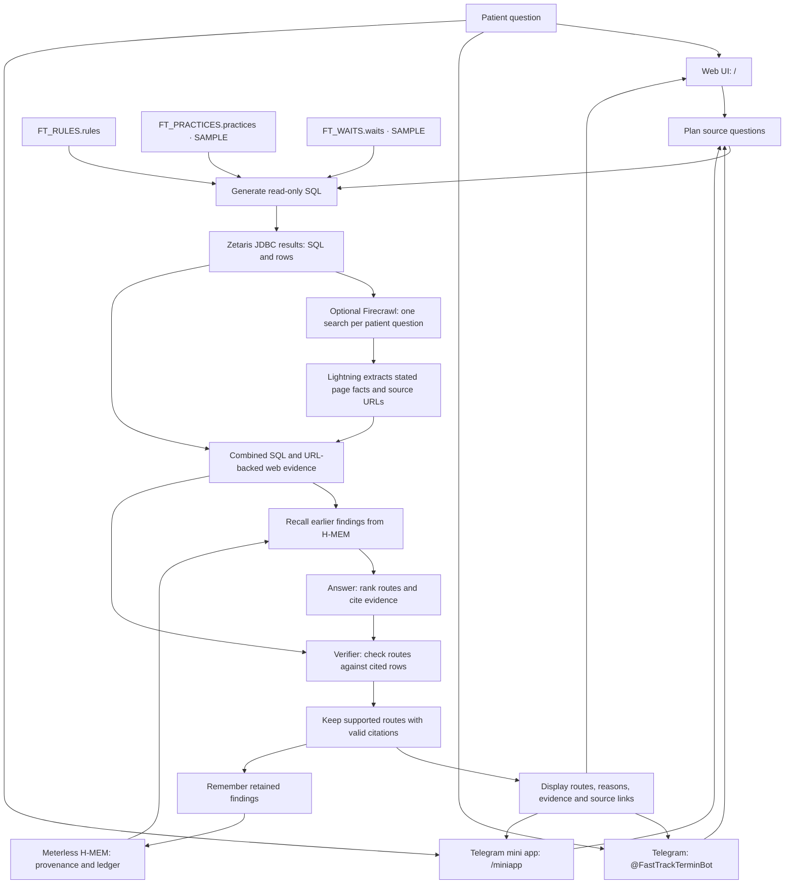

# FastTrack Termin

**The fastest route to a specialist appointment, with the evidence behind every reason.**

FastTrack Termin helps statutory-insurance patients in Berlin compare routes to a specialist appointment. It brings appointment-system rules, a practice directory, waiting-time observations and optional live web evidence into one agent workflow. Each retained recommendation includes a reason and evidence IDs that resolve to SQL result rows or URL-backed web rows.

Built for the **Open Agent Hackathon 2026**, Track 02 **"The Agent That Can Explain Why"**, and the **NVIDIA Nemotron prize**.

> **Demo data:** the seed practice directory and waiting times are **SAMPLE data**, not live availability or promised waiting times. Optional web rows carry their source URLs. This is not medical advice. **In an emergency, call 112.**

## How it works

The workflow is implemented in [fasttrack/agent.py](fasttrack/agent.py). See [Explainability: how an answer is built, checked and traced](docs/EXPLAINABILITY.md) for the worked test example and refusal boundaries.



1. **Plan:** Nemotron identifies the questions needed to answer the patient.
2. **Query:** a SQL-generation call produces a SELECT for each question. Results receive IDs such as `E1`, paired with their SQL and row. Query failures are recorded in the trace.
3. **Search the web (optional):** Lightning writes one search query for the original patient question. Firecrawl returns page content; Lightning extracts practice facts into URL-backed evidence rows. Web errors are recorded in the trace without stopping the SQL-backed workflow.
4. **Recall:** memory supplies earlier findings as context for the answer.
5. **Answer:** Nemotron ranks proposed routes, explains why and cites evidence IDs. Its prompt prefers web rows with URLs over SAMPLE rows and requires sample facts to be identified.
6. **Verify:** another model call checks each route against its cited rows. Unknown evidence IDs are stripped; routes are retained only when selected by the verifier and backed by at least one valid citation.
7. **Remember:** retained findings are sent to memory for later questions.

The response includes the source and memory backend names, a workflow trace and model-call metadata. The UI displays each retained route with its reason and evidence rows, including SQL for database evidence and clickable source URLs for web evidence. It also exposes the workflow trace and web-backend status. Verification is model-based; it is not a guarantee of factual correctness. The route verifier does not separately verify the answer's caveats.

## Sponsor technology

### Zetaris: federated SQL over three logical databases

[fasttrack/sources.py](fasttrack/sources.py) connects to Zetaris Lightning through JDBC. The agent uses the same schema-qualified SQL across these sources:

| Logical table | Seed file | Purpose |
| --- | --- | --- |
| `FT_RULES.rules` | [rules.csv](data/seed/rules.csv) | Appointment-system rules and their listed legal basis |
| `FT_PRACTICES.practices` | [practices.csv](data/seed/practices.csv) | SAMPLE practice directory |
| `FT_WAITS.waits` | [waits.csv](data/seed/waits.csv) | SAMPLE waiting-time observations, linked by practice ID |

[zetaris/register.py](zetaris/register.py) copies the CSV files into the platform's `driver` container, registers one Lightning database and filestore table per source, and reads back row counts over JDBC. This demo federates CSV-backed sources; it does not connect to live practice booking systems.

### Meterless: H-MEM with provenance and a ledger

The H-MEM reference implementation is **vendored unmodified** from [Meterless/Meterless](https://github.com/Meterless/Meterless), under Apache-2.0, in [meterless/hmem](meterless/hmem). Its pinned revision is recorded in [UPSTREAM_COMMIT](meterless/hmem/UPSTREAM_COMMIT).

The project's [TypeScript bridge](meterless/bridge.ts) connects Python to H-MEM using JSON over stdin/stdout. It stores a retained route and reason with a run tag and a `fasttrack:<run_id>` source. H-MEM persists state and its ledger under `runs/hmem` by default; `FT_HMEM_DIR` overrides that directory. Recall returns matching memories with their source and relevance.

The current H-MEM bridge stores route text and run-level provenance, rather than the full evidence-row payload. The agent response carries the cited SQL or web search, rows and web source URLs. The JSONL fallback stores the full record, including that evidence.

### NVIDIA Nemotron: a model for each role

[fasttrack/llm.py](fasttrack/llm.py) calls NVIDIA's OpenAI-compatible API at `https://integrate.api.nvidia.com/v1`. Its defaults are:

| Role | Model |
| --- | --- |
| Planner | Lightning 30B: `nvidia/nemotron-3.5-lightning-30b-a3b` |
| SQL generation | Lightning 30B: `nvidia/nemotron-3.5-lightning-30b-a3b` |
| Web search query (uses the `sql` role) | Lightning 30B: `nvidia/nemotron-3.5-lightning-30b-a3b` |
| Web fact extraction (uses the `verifier` role) | Lightning 30B: `nvidia/nemotron-3.5-lightning-30b-a3b` |
| Answer | Ultra 550B: `nvidia/nemotron-3-ultra-550b-a55b` |
| Verifier | Lightning 30B: `nvidia/nemotron-3.5-lightning-30b-a3b` |

The planner chooses what to investigate, SQL generation translates those questions, Lightning also writes the web search query and extracts page facts, Ultra produces the ranked explanation, and the verifier checks its routes against cited evidence. Model-call metadata records the role, model, elapsed seconds and token usage when returned by the API.

Override roles with `FT_MODEL_PLANNER`, `FT_MODEL_SQL`, `FT_MODEL_ANSWER` and `FT_MODEL_VERIFIER`. `NVIDIA_BASE_URL` overrides the API base URL. Your NVIDIA API account must have access to the configured models.

### Firecrawl: optional live web evidence

[fasttrack/web.py](fasttrack/web.py) makes **one Firecrawl search per patient question** when enabled, after the SQL queries and before memory recall. The cloud endpoint is `https://api.firecrawl.dev/v1/search`, authenticated with `FIRECRAWL_API_KEY`. For a self-hosted service, set `FIRECRAWL_URL` to its full search endpoint URL. The current implementation requires `FIRECRAWL_API_KEY` to enable either endpoint.

Nemotron Lightning is instructed to extract **only facts stated in the returned page text**, leaving unstated fields null. Extracted rows are accepted only when their URL matches a returned page URL. Each accepted web evidence row retains that source URL, and the UI links it. This URL check does not independently establish that each extracted fact is correct.

Booking portals excluded from automated access are **doctolib, jameda, docinsider and sanego**. The search appends site exclusions and filters returned URLs for those portal names. The answer is prompted to prefer URL-backed web rows over SAMPLE rows; web evidence does not establish live appointment availability.

## Setup

### Run with Docker

From the repository root, copy the template and fill in your credentials privately:

```sh
cp .env.example .env
```

PowerShell equivalent: `Copy-Item .env.example .env`. Fill `NVIDIA_API_KEY`, `FIRECRAWL_API_KEY` for live web evidence, and `TELEGRAM_BOT_TOKEN` for the bot. **`.env` is git-ignored and must never be committed.** Do not print or publish keys or the bot token.

Start the services using Docker with Compose:

```sh
docker compose up --build -d
docker compose ps
```

| Service | Purpose |
| --- | --- |
| `app` | Web UI at [http://127.0.0.1:8765](http://127.0.0.1:8765) |
| `tunnel` | Cloudflare quick tunnel exposing the app through public HTTPS |
| `bot` | Telegram chat interface for [@FastTrackTerminBot](https://t.me/FastTrackTerminBot) |

The shared app/bot image contains **Python 3.12, JRE 17** for the Zetaris JDBC driver, and **Node.js** for the Meterless H-MEM bridge. State under `runs/` is mounted from the host. The tunnel makes the app publicly reachable while it runs.

Compose reaches an existing host Zetaris platform at `host.docker.internal:10000`; it does not start Zetaris. Leave `ZETARIS_JDBC_JAR` empty for the local SQLite stand-in. To use Zetaris, set it non-empty, supply `ZETARIS_USER` and `ZETARIS_PASSWORD`, and set `ZETARIS_JDBC_DIR` to the host directory containing the driver JARs. Compose mounts that directory read-only and uses `/zetaris/jdbc` inside the containers. Register the sources using the manual Zetaris steps below before asking questions.

The bot reads the quick-tunnel hostname from cloudflared metrics at `http://tunnel:20241/quicktunnel` and sets its mini app menu button automatically. `FT_MINIAPP_URL` can override the mini app URL. Stop the services with `docker compose down`.

### Use it: web, Telegram and mini app

- **Web:** open [http://127.0.0.1:8765](http://127.0.0.1:8765), describe your specialist need, district and referral, then watch the live step timeline. The UI consumes NDJSON from `/ask/stream`. Route cards show expected days when provided and the reason; evidence chips reveal the SQL or web query and its row. Web rows link their source.
- **Act on cited details:** a cited row with a phone number enables a **Call** (`tel:`) button. An address enables **Route (OSM)** and **Route (Google)** buttons. **Use my location** optionally requests your position and uses Nominatim to geocode practice addresses for approximate straight-line distance, not travel time.
- **Telegram:** open [@FastTrackTerminBot](https://t.me/FastTrackTerminBot), select Start and ask your question. One status message is edited as agent steps finish; route messages follow with reasons, expected days when provided, and phone numbers, map and source links when present in cited rows.
- **Mini app:** use the bot's **FastTrack** menu button or **Open FastTrack app** button. `/miniapp` runs the same streamed flow inside Telegram, applies Telegram theme colours and uses its main button to submit a question.

For QR onboarding, install the host Python dependencies from `requirements.txt`, then run from the repository root with `TELEGRAM_BOT_TOKEN` in `.env` or the environment:

```sh
pip install -r requirements.txt
python -m fasttrack.telegram_bot --qr bot-qr.png
```

Scan the generated QR to open [t.me/FastTrackTerminBot](https://t.me/FastTrackTerminBot) for the configured bot. The helper obtains the username from Telegram rather than hard-coding it. The `.env` loader prints no values; Telegram errors redact the bot token.

### Manual setup: prerequisites and configuration

Use Python, Node.js with npm, a Java runtime for JDBC, and Docker with the Compose plugin. Obtain the **Zetaris platform kit and Lightning JDBC driver JAR separately**; this repository does not include the platform's Docker Compose configuration or driver.

Clone this repository and open a terminal at its root. The app and bot load the git-ignored `.env`; already-set environment variables take precedence. Registration reads the shell environment, so export its Zetaris settings there. Supply your own credentials privately; do not commit them.

| Variable | Value or purpose |
| --- | --- |
| `NVIDIA_API_KEY` | NVIDIA API credential, required by the app |
| `FIRECRAWL_API_KEY` | Firecrawl credential; enables optional live web evidence |
| `FIRECRAWL_URL` | Optional full search endpoint URL for self-hosted Firecrawl; defaults to `https://api.firecrawl.dev/v1/search` |
| `TELEGRAM_BOT_TOKEN` | Telegram bot credential, required for the bot and QR helper |
| `FT_MINIAPP_URL` | Optional HTTPS mini app URL; Compose discovers the tunnel URL automatically |
| `ZETARIS_USER` | Your Zetaris platform user |
| `ZETARIS_PASSWORD` | Your Zetaris platform password |
| `ZETARIS_JDBC_JAR` | Host run: Lightning JDBC JAR path or JAR directory. Compose: non-empty selects Zetaris; empty selects SQLite |
| `ZETARIS_JDBC_DIR` | Host directory of JDBC JARs mounted by Compose |
| `ZETARIS_PLATFORM` | Local directory containing the platform kit's Compose project, used by registration |

The default JDBC URL is `jdbc:zetaris:lightning@localhost:10000`; override it with `ZETARIS_JDBC_URL` if needed. Registration defaults to `C:\Tools\zetaris-platform` when `ZETARIS_PLATFORM` is absent, so set it explicitly for another location.

### Install dependencies

From the repository root:

```sh
pip install httpx jaydebeapi
cd meterless
npm install
cd ..
```

The Node dependency runs the H-MEM bridge through `tsx`.

### Start Zetaris and register the sources

In the separately supplied Zetaris platform directory, start its Compose project:

```sh
docker compose up -d
docker compose ps
```

Wait for the platform to be ready and its `driver` service to be running. Return to this repository's root, with the configuration above available, then run:

```sh
python zetaris/register.py
```

Check the reported counts for all three tables. Registration prints creation errors as `SKIP` before attempting the count queries; inspect those messages rather than assuming registration succeeded.

### Run the app

From the repository root:

```sh
python -m fasttrack.app
```

Open **[http://127.0.0.1:8765](http://127.0.0.1:8765)**. Host runs bind to loopback by default; `FT_HOST` and `FT_PORT` override the bind address and port. Compose binds the app inside its container and publishes the host port on loopback, while the tunnel supplies public HTTPS. Stop a foreground host server with Ctrl+C.

The page contains an example question about an orthopaedics appointment in Köpenick with a GP referral but no urgency code. Edit it, select **Find the fastest route**, then inspect the proposed routes, reasons and evidence rows. When web evidence is enabled, follow its source links to inspect the original pages. The footer identifies the active source, web and memory backends.

### Fallbacks and tests

Without `ZETARIS_JDBC_JAR`, the agent uses an in-memory SQLite stand-in with the same three logical schemas and seed files. H-MEM is selected when its bridge and local `tsx` executable are available. Set `FT_MEMORY=local`, or omit the bridge installation, to use `runs/memory.jsonl` instead. A runtime H-MEM bridge error is reported; it does not silently switch to JSONL.

Without `FIRECRAWL_API_KEY`, web search is disabled. Web search failures appear in the trace; the remaining evidence workflow continues.

These fallbacks support development, but do not demonstrate the live Zetaris/H-MEM integration. The app still requires NVIDIA API access.

Run the offline unit tests from the repository root:

```sh
python -m unittest tests.test_agent
```

The tests use a fake model, SQLite and temporary JSONL memory. They cover cross-schema querying and citation filtering, the SQL guard, memory recall and JSON parsing. They do not test live NVIDIA, Zetaris, H-MEM or Firecrawl services.

## Data and limitations

- **Seed practices and waiting times are SAMPLE data.** They are not verified practice listings, live appointment slots or guaranteed waiting periods. Optional web rows are separate, URL-backed evidence extracted from returned pages.
- Rules cite the legal basis listed in [data/seed/rules.csv](data/seed/rules.csv). The application queries those seed rules; it does not retrieve or validate current legislation.
- Recommendations depend on the supplied data and model output. The app recommends routes; it does not book appointments.
- **Not medical advice. In emergencies, call 112.**

## Licences

- FastTrack Termin application code and integration bridge: **GNU AGPL-3.0-or-later**, as marked in the source headers. See [LICENSE](LICENSE).
- Vendored Meterless H-MEM: **Apache License 2.0**. See its [LICENSE](meterless/hmem/LICENSE), [NOTICE](meterless/hmem/NOTICE) and [upstream revision](meterless/hmem/UPSTREAM_COMMIT).
- The separately supplied Zetaris platform, JDBC driver, NVIDIA API/models, Firecrawl, Telegram, Cloudflare and map services remain subject to their respective providers' terms.
